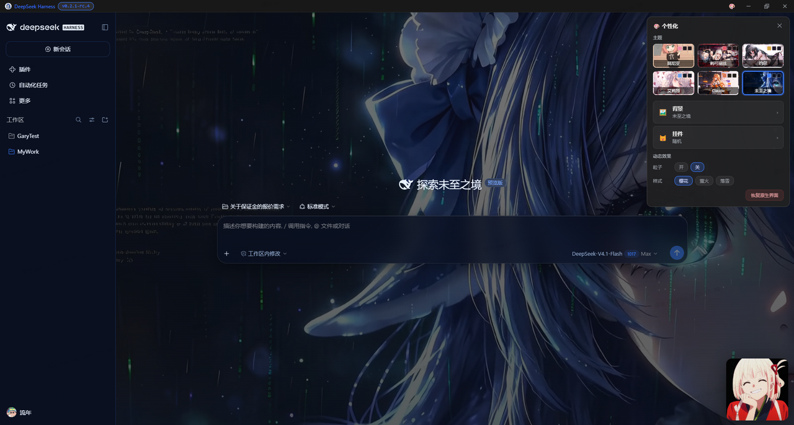

# DSH Desktop（自研 Electron 桌面壳 + 二次元主题插件）



> 把 DeepSeek Harness（dsh）Web 端封装成**真正的桌面应用**：独立 Electron 窗口、骨架屏秒开启动、
> 服务常驻（退出重开约 1.5 秒）、壳内一键更新，配合整套二次元主题插件。
> **更新安全性**：不修改上游任何文件，dsh 更新不影响封装——依赖锚点比对与失效预案见
> [UPGRADE-NOTES.md](UPGRADE-NOTES.md)。

二次元视觉主题按 dsh「一切皆插件」的理念做成**标准 dsh 插件** `dsh-anime-theme`（见 `dsh-anime-theme/`），
桌面壳只负责窗口 chrome 与系统集成，两者解耦。

> 官方桌面版（`@deepseek-ai/dsh-desktop`）也已发布；本壳定位为**个性化替代**——
> 整套主题接管、自绘顶栏与启动加载体验是官方壳不提供的，两者可并存（安装目录与快捷方式互不冲突）。

> 上游官方仓库 [deepseek-ai/deepseek-harness](https://github.com/deepseek-ai/deepseek-harness)；
> `deepseek-harness/` 为上游源码克隆（不入库，作依赖锚点比对参考），日常运行走官方 npm 版，两者等价。

## 特性

### 桌面壳（desktop/）

- 🖥️ **真桌面窗口**：Electron 原生窗口 + 自有图标/任务栏标识
- 🚀 **秒开启动**：窗口出现瞬间即呈现界面骨架（侧栏/会话列表/输入区占位）与进度条 + 实时耗时，
  服务就绪后无缝切入真实界面
- ♻️ **服务常驻**：退出应用后 dsh 服务在后台保留，再次打开约 1.5 秒进入完整界面
  （后台最多保留 4 小时自动回收）；壳更新重启同样秒开
- 🌗 **一体化标题栏**：隐藏原生标题栏，深/浅主题自动切换标题栏与窗口按钮配色
- 🔢 **版本徽标 + 版本说明中心**：头部显示 dsh 运行时版本，**点击打开版本说明弹窗**——
  当前版本的官方更新说明（GitHub Releases，中文优先）+ 可展开的历史版本说明 + 检查更新入口；
  检测拉全渠道 packument（含 `latest` / `next` / `alpha` 标签——上游 alpha 线不进 latest，
  只查 `/latest` 会漏检）
- ⬆️ **壳内一键更新**：同一次检查覆盖 dsh 运行时与桌面壳自身（GitHub Releases），
  下载（实时进度）→ 静默安装并重启，会话与设置不受影响，不必手动去 Releases 下载
- ⏳ **更新断点续传**：点「立即更新」后可随时关闭弹窗，安装自动转后台继续；
  再点版本徽标即回到实时进度（含已累积日志回放）；重启生效始终由用户确认
- 📝 **版本说明弹窗**（`notes.html`）：拉取官方 GitHub Releases 渲染当前版本说明
  （中文段优先、自动截断英文段），历史版本逐条折叠展开；结果落盘缓存，
  断网时用缓存兜底并标注
- 🛟 **坏更新自动回退**：启动时若「应用内更新运行时」起不来（如新版本与旧 profile
  数据不兼容），自动清除该运行时并回退原 CLI 重试一次，弹窗说明原因
- 📌 **托盘运行**：首次关闭询问「最小化到托盘 / 直接退出」可记住选择，托盘菜单可改；
  直接退出时服务后台保留（约 4 小时）以便下次秒开
- ⚡ **服务自管理**：自动定位并启动 `dsh web`（分离进程，独立于应用会话存活）

### 二次元主题插件（dsh-anime-theme/）

- 🌸 **整套主题接管**（参考 Vencord / DSH-Transparent-UI 等高分主题插件的手法）：
  深浅两套配色全覆盖——壁纸全屏铺底，侧栏与输入框变成悬浮玻璃卡片
  （圆角 + 毛玻璃 blur + 描边 + 内高光），对话区透明透出壁纸
- 🎨 **主题面板**（Win11 设置式交互）：标题栏 🎨 圆钮打开；主页主题卡片网格 + 背景/挂件分组行，
  壁纸/挂件管理收进子页（‹ 返回导航）
  - **主题 = 全局配色**：六套主题（阿尼亚粉暖 / 莉可丽丝红 / 约尔暗金紫 / 艾莉莎银蓝 / Claude 暖橙 / 未至之境深蓝）
    经 dsh 官方配色变量整套覆盖，切换即全界面变色；**主题卡 = 组合预览**（壁纸缩略图打底 +
    配色角标，点击应用整套：配色 + 推荐壁纸 + 推荐挂件），背景与主题解耦
  - 壁纸 13 款（≥2K 高清）：木屋 / 锦鲤 / 蔷薇 / 樱雪 / 草原 / 蕾丝 / 紫绫 / 幽梦 / 花眠 / 银姬 / 花信 / 浮光 / Claude
    + **📎 上传自定义壁纸**（可多选，自动压缩，多张管理）+ **🎬 动态壁纸**（mp4/webm ≤30MB；
    未至之境主题自带包内动态视频壁纸，海报帧作主题卡缩略图）
  - 挂件 8 套 24 个动图：随机 / 阿尼亚 / 莉可丽丝 / 约尔 / 艾莉莎 / 百花 / 败犬 / 魔女 / 邻家 /
    **我的（📎 上传自定义 GIF）** / 无，大小三档
  - 自定义壁纸 / 挂件均为**缩略图管理**：点击选用、悬停 ✕ 单独删除；删除选中项自动回退默认
  - 浓度（深 / 中 / 浅）联动壁纸遮罩与药丸底色；**粒子动效**三样式（樱花花瓣 / 萤火 / 落雪六角雪花）可开关可选
  - 关闭主题后再点按钮显示「主题已关闭」空面板，只有显式点「开启主题」才恢复原生
- 📤 **原生功能保全**：Session log 导出按钮保留；下载静默存入系统下载目录并托盘气泡提示；
  窗口内导航限制、缩放快捷键齐备
- 🎛️ **壳顶栏跟随主题**：品牌名 / 🎨 / 版本徽章随主题强调色染色，深浅切换不覆盖
- 🐱 **右下角随机动图挂件**，每次启动换一个
- 🧩 **自动扩展**：往 `assets/wallpapers/` 丢 jpg、往 `assets/anime/<套装名>/` 丢 gif，
  `node build.mjs` 后新壁纸/新套装自动出现在面板里

## 下载安装（GitHub Releases）

安装包与便携版发布在本仓库 GitHub [Releases](https://github.com/huantest2024/dsh/releases) 页：

| 平台 | 文件 | 说明 |
|------|------|------|
| Windows | `DSH-Desktop-Setup-<v>.exe` | NSIS 安装包（可选安装目录，卸载保留数据） |
| Windows | `DSH-Desktop-Portable-<v>.exe` | 单文件便携版 |
| Windows | `DSH-Desktop-Windows-<v>-x64.zip` | 便携 ZIP（解压即用） |
| macOS | `DSH-Desktop-macOS-<v>-<arch>.dmg` | 安装包（x64 / arm64） |
| macOS | `DSH-Desktop-macOS-<v>-<arch>.zip` | 便携 ZIP |

- 两平台都**需要本机已装 Node.js**（跑 dsh 服务本身）
- mac 版未做开发者签名：首次打开用访达右键 →「打开」，或
  `xattr -cr "/Applications/DSH Desktop.app"` 清除隔离属性
- 数据目录：本应用数据在 `%APPDATA%\DSH Desktop`（设置/运行时/日志），会话数据在 `~/.dsh`；
  与官方桌面版互不影响
- 新版本发布方式：合并代码后打 `v*` 标签推送，GitHub Actions 自动双平台构建并更新 Release

## 快速开始

### 1. 桌面壳

```powershell
cd desktop
npm install        # 首次；走 .npmrc 里的 npmmirror 镜像
npm start          # 开发模式
npm run dist       # 打包：release\DSH-Desktop-Setup-*.exe / Portable-*.exe，
                   #      并自动把 CHANGELOG.md 复制为 release\版本更新说明.md
```

### 2. 二次元主题插件（安装到 web profile）

本机没有 pnpm 也能装（插件源码在 `dsh-anime-theme/`，产物已构建），手动安装：

```powershell
# 1) 拷贝插件包到 profile 的 node_modules
Copy-Item -Recurse -Force dsh-anime-theme "$env:USERPROFILE\.dsh\profiles\node_modules\dsh-anime-theme"

# 2) 在 ~/.dsh/profiles/web/package.json 的 dsh.profile.bundles 数组里追加 "dsh-anime-theme"
```

重启桌面应用即生效（插件集变更需重启 dsh 服务）。验证：
`http://127.0.0.1:3188/plugins/dsh-anime-theme/client.js` 返回 200。

改过插件素材后重新构建：`cd dsh-anime-theme && node build.mjs`，再拷贝 `lib/client.js` 到 profile 并重启。

## 配置

| 变量 | 默认值 | 说明 |
|------|--------|------|
| `DSH_PORT` | `3188` | Web 服务端口 |
| `DSH_HOME` | `~/.dsh` | DeepSeek Harness 数据目录 |
| `DSH_CLI_PATH` | 自动检测 | 直接指定 dsh CLI 的 `bin.js` 路径 |
| `DSH_NODE_PATH` | 自动检测 | 直接指定 node 可执行文件路径（win: node.exe；mac: node） |
| `DSH_NPM_REGISTRY` | `https://registry.npmmirror.com` | 更新检测/安装使用的 npm registry |

CLI 定位顺序：应用更新运行时（`userData\dsh-runtime`）→ `DSH_CLI_PATH` → npx 缓存
→ 全局 npm → `~/.dsh/profiles` → 兜底 `npx -y @deepseek-ai/dsh@latest`。

桌面设置（关闭行为等）：开发模式在 `desktop/desktop-settings.json`，
打包后在 `%APPDATA%\DSH Desktop\desktop-settings.json`。

## 目录结构

```
DSH/
├── deepseek-harness/    # 上游源码克隆（不入库）
├── dsh-anime-theme/     # 二次元主题 dsh 插件（标准 dsh.client + dsh.bundle 结构）
│   ├── build.mjs        # 生成 lib/client.js（内嵌壁纸/动图 base64）
│   ├── assets/          # 壁纸 + 动图素材（可自行增删 GIF 后重新 build）
│   ├── lib/index.js     # 宿主侧插件（无逻辑，仅为 loader entry）
│   ├── lib/client.js    # 浏览器端：壁纸/玻璃面板/挂件（__ModuleLoader__ 工厂格式）
│   └── cordis.patch.yml # bundle patch：把插件挂进 cordis 插件树
└── desktop/             # Electron 桌面壳（应用名：DSH Desktop）
    ├── main.js          # 主进程：CLI 定位 / 服务管理与常驻交接 / 主题上报 / 更新 / 托盘
    ├── preload.js       # 内容页 ↔ 主进程桥（主题上报、壳命令）
    ├── bar.html         # 自绘顶栏（品牌 + 版本徽标 + 🎨 + 窗口控制，独立 WebContentsView）
    ├── bar-preload.js   # 顶栏 ↔ 主进程桥（拖拽/窗口操作/徽标状态）
    ├── notes.html       # 版本说明与更新弹窗（检查/进度/完成/失败四阶段单窗口）
    ├── update-preload.js# 弹窗 ↔ 主进程桥（更新事件订阅 + 安装/重启/关闭 + 壳更新）
    ├── popup-bar.html   # 壳内浏览器弹窗顶栏（登录授权页等）
    ├── popup-preload.js # 弹窗页 ↔ 主进程桥
    ├── installer.nsh    # NSIS 安装/卸载钩子（升级杀进程、卸载数据可选清理）
    ├── CHANGELOG.md     # 桌面壳版本迭代更新说明（打包时复制进 release）
    ├── scripts/         # 打包收尾脚本（复制版本说明进产物目录）
    ├── splash/          # 启动加载页（dsh 布局骨架屏 + 进度条）
    ├── assets/          # 图标 + 内置主题插件母本（plugin/，防删自愈用）
    └── release*/        # 打包产物（gitignore）
```

## 插件机制备忘（踩坑记录）

- 包必须声明 `dsh.client`（package.json）+ `exports["./client"]` 指向浏览器产物；
  **exports 里必须包含 `"./package.json"`**，否则 host 解析包清单时
  `ERR_PACKAGE_PATH_NOT_EXPORTED`，插件被静默跳过（boot 图无此插件、/plugins/ 404）
- 浏览器产物必须是 `window.__ModuleLoader__.load({ id, factory })` 工厂注册格式
- 插件集变更需重启 `dsh web`；样式插入顺序早于官方样式表时用 `html body[...]` 提特异性
- 深浅色由 dsh 原生主题驱动（`~/.dsh/settings.yaml` 的 `ui-theme.preference`），
  主题 CSS 全部限定在 `body[data-ds-dark-theme]` 作用域下

## 与上游官方仓库的关系

上游官方仓库：[deepseek-ai/deepseek-harness](https://github.com/deepseek-ai/deepseek-harness)
（npm 包 `@deepseek-ai/dsh` 即由此发布）。官方提供 CLI / Web UI 与官方桌面版
（`@deepseek-ai/dsh-desktop`）；本仓库的桌面壳（Electron 封装、启动体验、更新机制、主题插件）
为自研薄封装，不修改上游任何文件，安装与**官方桌面版可并存**（目录/快捷方式独立）。

上游源码运行方式（见官方 README）：

```sh
git clone https://github.com/deepseek-ai/deepseek-harness.git
cd deepseek-harness
pnpm install
pnpm run build
pnpm dsh web
```

`deepseek-harness/` 目录为上游仓库的克隆（不入库，作依赖锚点比对参考），
当前克隆版本 0.2.2-alpha.2（上游最新发布 tag）；日常运行走官方 npm 版，两者等价。

## 桌面壳设计说明与路线图

已落地的壳层设计要点：

- **窗口内导航限制**：`will-navigate` 只放行本机服务与启动页；弹新窗口/外链仅转发
  `http(s)` 给系统浏览器，其余（UNC 路径、自定义协议等畸形地址）拦截并落日志，
  避免把垃圾字符串交给 ShellExecute 弹「Windows 找不到」错误框
- **缩放快捷键**：`Ctrl+=` / `Ctrl+-` / `Ctrl+0`
- **backdrop-filter 兼容坑**：含 fixed 弹层（如设置抽屉）的容器必须摘除 blur，
  否则 fixed 包含块被劫持、抽屉被压进侧栏宽度（同 Aqua 插件的 `:has` 兼容做法）

更重的工程化设计（当前单机自用暂不引入，作为路线图）：

| 方向 | 做法 | 引入条件 |
|------|-----------|---------|
| 免 Node 运行时 | 内置 node/pnpm 运行时 + `app.asar.unpacked` 物理依赖 | 需要分发给无 Node 环境的同事时 |
| generation 生命周期 | 窗口/托盘/监听/子进程按代持有，切换 profile 整代 dispose | 引入多 profile 切换时 |
| 插件市场 | 内置 dsh-community-market，开放插件数据源 Schema | 想在应用内发现/安装插件时 |
| 恢复诊断页 | 渲染进程健康检查 + 独立沙箱恢复窗口 | 追求开箱即用健壮性时 |
| 固定上游 + patches | 上游子模块固定版本原样运行，升级=换 pin | 当前用官方 npm 版已等价 |

## 注意事项

- 需要本机已装 Node.js（跑 dsh 服务本身；mac 推荐 `brew install node`）
- 应用数据在 `%APPDATA%\DSH Desktop`（设置/运行时/缓存/日志）；会话数据在 `~/.dsh`，
  卸载或改名均不受影响
- 退出行为：直接退出后 dsh 服务在后台保留约 4 小时（下次打开秒进，到期自动结束）；
  托盘「退出」同此；运行时有版本更新时重启走冷启动（正确行为）
- mac 版登录预热（开机预启服务）不可用（依赖 Windows Run 键），首开需等服务冷启动
- 深/浅色偏好：改 `~/.dsh/settings.yaml` 的 `ui-theme.preference`（dark/light/system）
- 多实例：默认单实例锁，重复启动只会聚焦已有窗口
